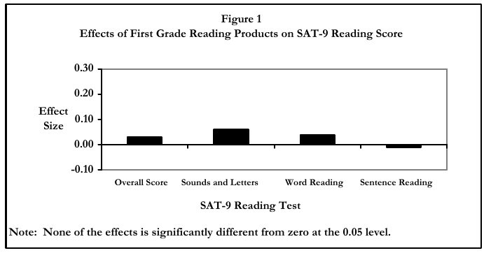
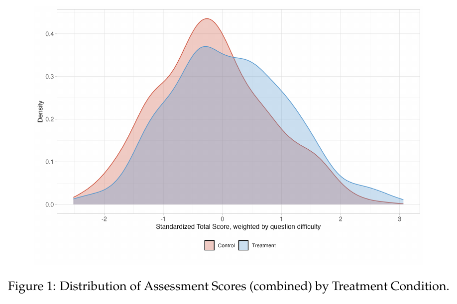

Read each study assigned to your group. For each, decide the **direction of findings** (positive, negative, mixed, null, inconclusive) and rate **credibility** from 1 (low) to 5 (high). Write one reason.

# Source A

**What was studied.** How often 15-year-olds use computers at school, and how that use relates to their performance on an international assessment of reading, mathematics, and science. The data come from the 2012 round of PISA, a large international survey in which students in dozens of countries sit the same tests and answer questionnaires about computer access and use. In the participating wealthy countries, 96% of students reported a computer at home and 72% reported using one at school.

**How was it studied.** A secondary analysis of cross-sectional survey data. The report builds an index of how frequently students do a range of things on computers at school (browsing, email, chatting, drill and practice) and plots average test performance against that index, after adjusting for the socioeconomic status of students and schools. It also compares countries: how much each invested in school technology and how its scores changed over time. The report states that with "non-experimental, cross-sectional data such as those gathered through PISA, even sophisticated statistical techniques cannot isolate the cause-and-effect relationship."

**What was found.** The relationship between school computer use and reading performance is, in the report's words, "graphically illustrated by a hill shape." Students who used computers slightly less than the average did best. Students who used them rarely did somewhat worse, and students who used them much more than average did a lot worse, even after adjustment. At the country level, "resources invested in ICT for education are not linked to improved student achievement in reading, mathematics or science," and countries that invested less improved faster. The report's foreword summarizes the classroom evidence as "mixed at best."

**Who produced it.** The OECD, an intergovernmental economic organization, through its secretariat, steered by a board of participating governments. It is the organization's flagship education publication and is not peer reviewed in the journal sense. No external sponsor is named and no conflicts are declared.

**Citation.** OECD. (2015). *Students, computers and learning: Making the connection.* PISA, OECD Publishing. [https://doi.org/10.1787/9789264239555-en](https://doi.org/10.1787/9789264239555-en)

**Direction:** positive / negative / mixed / null / inconclusive

**Credibility (1–5):** ____  **Reason:** ______________________________________________

\newpage

# Source B

**What was studied.** MAP Accelerator, a free online mathematics practice platform built by Khan Academy in partnership with NWEA, the maker of the MAP Growth interim assessment. The platform assigns practice based on each student's fall assessment results. The data cover 181,359 students in grades 3 to 8 from 99 school districts and 649 schools in the United States during the 2020–21 school year, a year disrupted by the pandemic. About half the students attended schools where most students qualified for free or reduced-price lunch.

**How was it studied.** This was not an experiment. Students were sorted into four groups by how much they used the platform: none, under 15 minutes a week, 15 to 29 minutes, and 30 or more minutes. The provider's recommended dose is 30 minutes a week, roughly one class period. The authors compared fall-to-spring growth across the usage groups, adjusting for fall scores, demographics, and school, district, and teacher effects. They also compared math growth with reading growth for the same students, reasoning that an unmeasured factor affecting both subjects would show up in reading, which the platform does not teach. In their words, "this was still an observational study and does not provide the same quality of causal evidence as a randomized control trial."

**What was found.** Students who used the platform 30 or more minutes a week grew 0.26 standard deviations more in math than similar students who used it less than 15 minutes a week (95% confidence interval 0.20 to 0.31). The association was positive across gender, racial and ethnic groups, and school poverty levels, and smaller in districts with many English learners. Heavier users also showed higher reading growth, which the authors say "suggests possible unobserved confounding." Only 5% of students reached the recommended dose; 41% never used the platform.

**Who produced it.** Three researchers employed by Khan Academy, the organization that makes the platform. The report was reviewed by an external advisory board but not peer reviewed. Khan Academy's sales page for districts cites the finding as evidence that the platform "accelerates learning." No funding statement appears in the report.

**Citation.** Weatherholtz, K., Grimaldi, P. J., & Hill, K. M. (2022). *Use of MAP Accelerator associated with better-than-projected gains in MAP Growth scores* (Technical report). Khan Academy. [http://khan.co/MATechReport2022](http://khan.co/MATechReport2022)

**Direction:** positive / negative / mixed / null / inconclusive

**Credibility (1–5):** ____  **Reason:** ______________________________________________

\newpage

# Source C

**What was studied.** Whether commercial reading and mathematics software raised test scores. The No Child Left Behind Act of 2001 required the U.S. Department of Education to study the effectiveness of educational technology using "scientifically based research methods and control groups." Sixteen products were chosen from public submissions and expert review, grouped into first-grade reading, fourth-grade reading, sixth-grade mathematics, and algebra. The study ran in the 2004–05 school year.

**How was it studied.** A randomized controlled trial. Within each school, volunteering teachers were randomly assigned to use a study product or not. Control teachers could keep using whatever other technology was already in their classrooms. Thirty-three districts, 132 schools, and 439 teachers took part; 9,424 students were in the analysis sample. Outcomes were nationally normed standardized tests in reading and mathematics and a standard algebra end-of-course test. Companies volunteered their products, suggested many participating districts, trained the teachers, and provided technical support.

**What was found.** "Test scores in treatment classrooms that were randomly assigned to use products did not differ from test scores in control classrooms by statistically significant margins." In first grade, effect sizes ranged from −0.01 to 0.06 standard deviations, equivalent to zero to two percentile points, none significant. The pattern held in each grade and subject. Effects of reading products were larger in first-grade classrooms with fewer students per teacher and in fourth-grade classrooms that used the product more.

**Who produced it.** Mathematica Policy Research and SRI International, two independent contract research firms, under contract to the U.S. Department of Education, which reported the results to Congress. Vendors participated on the understanding that results would be reported only for groups of products, not by name. The report is in the public domain.

**Citation.** Dynarski, M., Agodini, R., Heaviside, S., Novak, T., Carey, N., Campuzano, L., Means, B., Murphy, R., Penuel, W., Javitz, H., Emery, D., & Sussex, W. (2007). *Effectiveness of reading and mathematics software products: Findings from the first student cohort* (NCEE 2007-4005). U.S. Department of Education, Institute of Education Sciences. [https://ies.ed.gov/sites/default/files/migrated/nces_pubs/ncee/pdf/20074005.pdf](https://ies.ed.gov/sites/default/files/migrated/nces_pubs/ncee/pdf/20074005.pdf)

{width=80%}

**Direction:** positive / negative / mixed / null / inconclusive

**Credibility (1–5):** ____  **Reason:** ______________________________________________

\newpage

# Source D

**What was studied.** How widely students and teachers in U.S. public schools use artificial intelligence tools, how often, and whether schools provide guidance. The report does not estimate any effect on learning. It describes use, drawing on eight nationally representative survey panels of students, parents, teachers, principals, and district leaders fielded between October 2024 and June 2025, plus ten interviews with district leaders.

**How was it studied.** Descriptive, weighted tabulations of survey responses. The largest sample is 8,601 English language arts, mathematics, and science teachers surveyed in spring 2025 and asked how frequently they had used AI tools for instructional planning or teaching that school year. Students were 1,261 middle and high schoolers surveyed in early 2025. Weights make the results nationally representative of each population. The findings are self-reports of use, not measures of what students or teachers did with the tools or what they learned.

**What was found.** In 2025, 54% of middle and high school students said they used AI for schoolwork to some extent, and 21% at least weekly; use rose from 41% in middle school to 61% in high school. Among teachers, 53% reported using AI for planning or teaching, about 13% weekly; 42% of elementary teachers, 64% of middle school teachers, and 69% of high school teachers. A year earlier the teacher figure was 25%. Thirty-five percent of district leaders said they had trained students on AI, and over 80% of students said no teacher had explicitly taught them how to use it for schoolwork. Forty-five percent of principals reported a school or district AI policy.

**Who produced it.** The RAND Corporation, a nonprofit policy research organization, in partnership with the MIT Teaching Systems Lab and the Center on Reinventing Public Education. Funding came from gifts from RAND supporters and income from operations. The report is not peer reviewed. RAND does not sell or evaluate any product.

**Citation.** Doss, C. J., Bozick, R., Schwartz, H. L., Chu, L., Rainey, L. R., Woo, A., Reich, J., & Dukes, J. (2025). *AI use in schools is quickly increasing but guidance lags behind: Findings from the RAND Survey Panels* (RR-A4180-1). RAND Corporation. [https://www.rand.org/pubs/research_reports/RRA4180-1.html](https://www.rand.org/pubs/research_reports/RRA4180-1.html)

**Direction:** positive / negative / mixed / null / inconclusive

**Credibility (1–5):** ____  **Reason:** ______________________________________________

\newpage

# Source E

**What was studied.** A Romanian government program gave low-income families a voucher worth about 200 euros toward a home computer. In 2008, 52,212 households applied and met the income threshold; the budget covered 35,484 vouchers, so applicants were ranked by family income per household member and vouchers went to those below a cutoff. The question was whether having a computer at home changed children's school performance and skills.

**How was it studied.** A regression discontinuity design. Families just below the income cutoff received vouchers; families just above did not. Because the two groups are nearly identical in income, comparing them isolates the effect of the voucher for families near the cutoff. Researchers surveyed 3,354 families in 2009, about 52% of those contacted, covering roughly 5,900 children aged 7 to 19. Outcomes were school grades in mathematics, Romanian, and English, a test of computer skills, a nonverbal reasoning test, and parent and child reports on how the computer was used.

**What was found.** Winning a voucher raised the probability of owning a computer by more than 50 percentage points and increased children's computer use by three to four hours a week. Children in voucher-winning households had lower grades in all three subjects, with most estimates near one third of a standard deviation. They scored higher on the computer-skills test and on the reasoning test, also by about one third of a standard deviation. Few computers had educational software; most had games. Children who won a voucher were 14 percentage points more likely to play computer games daily and reported less time on homework. Where parents had rules about homework, the negative effect on grades was about half as large.

**Who produced it.** Two university economists in the United States, at the University of Chicago and Columbia University, with funding from private research foundations and university research centers. The paper was published in a peer-reviewed economics journal. Neither author discloses a relationship with a technology vendor.

**Citation.** Malamud, O., & Pop-Eleches, C. (2011). Home computer use and the development of human capital. *Quarterly Journal of Economics, 126*(2), 987–1027. [https://doi.org/10.1093/qje/qjr008](https://doi.org/10.1093/qje/qjr008)

**Direction:** positive / negative / mixed / null / inconclusive

**Credibility (1–5):** ____  **Reason:** ______________________________________________

\newpage

# Source F

**What was studied.** High-dosage tutoring, meaning small-group tutoring several times a week during the school day, often delivered with the support of software and in some sites by remote tutors. The study asked whether tutoring produces learning gains when districts run it at scale, and whether a lower-cost version works as well. Data cover 2023–24 across eight state, district, and charter partners in the United States, grades K to 12, in mathematics and reading.

**How was it studied.** A randomized controlled trial. 17,330 students were randomly assigned to standard high-dosage tutoring (about $2,000 per student), a "sustainable" lower-cost version (about $1,200 per student, with larger groups or more technology), or business as usual. The analytic sample was 16,435 students. Outcomes were standardized test scores. The report gives both the effect of being assigned to tutoring and the effect for students who actually received it. All findings are labeled preliminary, and comparison students were also receiving pandemic-recovery services funded by federal relief money.

**What was found.** Pooled effects of being assigned to tutoring were 0.046 standard deviations for the standard version and 0.065 for the lower-cost version, about one to two months of additional learning. Effects for students who received tutoring were 0.055 and 0.085. Across sites, the standard version's effects ranged from 0.008 to 0.13 standard deviations. Students received far less tutoring than planned: 631 to 2,287 minutes a year, against 2,030 to 4,940 in the earlier small studies that motivated the program. The authors conclude, "Lower cost models ($1200 per student) are just as effective as higher cost models ($2000 per student)."

**Who produced it.** The University of Chicago Education Lab and MDRC, a nonprofit evaluation firm, with funding from a list of private foundations and individual donors, several of whom also fund tutoring programs. The interim report has not been peer reviewed. Neither organization sells tutoring.

**Citation.** Bhatt, M. P., Chau, T., Condliffe, B., Davis, R., Grossman, J., Guryan, J., Ludwig, J., Magnaricotte, M., Mattera, S., Momeni, F., Oreopoulos, P., & Stoddard, G. (2025). *Personalized Learning Initiative interim report: Findings from 2023–24.* University of Chicago Education Lab and MDRC. [https://educationlab.uchicago.edu/](https://educationlab.uchicago.edu/)

**Direction:** positive / negative / mixed / null / inconclusive

**Credibility (1–5):** ____  **Reason:** ______________________________________________

\newpage

# Source G

**What was studied.** An after-school program in Benin City, Nigeria, in which first-year senior secondary students used Microsoft Copilot, a general-purpose generative AI chatbot powered by GPT-4, to practice English. Students met twice a week for six weeks in school computer labs, twelve 90-minute sessions in all, working in pairs on one computer with a teacher present. The question was whether the program improved English achievement.

**How was it studied.** A randomized controlled trial. Nine public schools with computer labs were selected. Of eligible students, 52% expressed interest; from that pool, 657 were randomly assigned to the program and 671 to a control group that received nothing. The outcome was an assessment covering English topics aligned with the national curriculum, knowledge of artificial intelligence, and digital skills, plus the school's regular end-of-term English exam. Attrition was high and uneven: 422 of 657 treated students and 337 of 671 control students completed the final assessment.

**What was found.** Students in the program scored 0.31 standard deviations higher on the combined assessment (standard error 0.068) and 0.23 standard deviations higher on the English portion. The effect on the school's own term exam was 0.21 standard deviations. Effects were largest for girls and for students with higher starting scores. The authors translate the gain into "1.5 to 2 years of 'business-as-usual' schooling." The authors report bounds that remain positive under conservative assumptions about who dropped out.

**Who produced it.** Six researchers at the World Bank's Education Global Department, with financial support from the Mastercard Foundation. The chatbot was a free commercial product; the paper reports no funding, co-design, or other role for Microsoft or OpenAI. It is a working paper, not peer reviewed.

**Citation.** De Simone, M., Tiberti, F., Barron Rodriguez, M., Manolio, F., Mosuro, W., & Dikoru, E. J. (2025). *From chalkboards to chatbots: Evaluating the impact of generative AI on learning outcomes in Nigeria* (Policy Research Working Paper 11125). World Bank. [https://doi.org/10.1596/1813-9450-11125](https://doi.org/10.1596/1813-9450-11125)

{width=80%}

**Direction:** positive / negative / mixed / null / inconclusive

**Credibility (1–5):** ____  **Reason:** ______________________________________________

\newpage

# Source H

**What was studied.** Whether giving high school students access to GPT-4 while they practice mathematics helps or hurts what they learn. The study took place in one large high school in Turkey during fall 2023, in about fifty 9th, 10th, and 11th grade classes with nearly 1,000 students, over four 90-minute sessions covering about 15% of the semester's math curriculum.

**How was it studied.** A randomized controlled trial with classrooms assigned to one of three conditions. In one, students practiced with a chat interface built on GPT-4, similar to the public ChatGPT. In a second, students used the same model behind prompts written to act as a tutor, giving hints without full solutions. The control condition practiced with notes and the textbook. Each session had a review lecture, a practice period, and then a closed-book exam on similar problems with no AI access. The design and analysis were preregistered.

**What was found.** During practice, students with the plain chatbot did 48% better than control, and students with the tutor version did 127% better. On the unassisted exam, students who had used the plain chatbot scored 17% worse than control; the difference was statistically significant. Students who had used the tutor version scored the same as control. The plain chatbot gave a wrong final answer with a logical error 42% of the time and an arithmetic error 8% of the time on the practice problems. The authors conclude students "attempt to use [the chatbot] as a 'crutch' during practice problem sessions, and when successful, perform worse on their own."

**Who produced it.** Researchers at the Wharton School of the University of Pennsylvania and its AI and Analytics Initiative, with a partner school in Ankara. Funding came from Wharton's own research centers. The paper was peer reviewed and published in PNAS in 2025. The authors declare no competing interests and report no relationship with OpenAI.

**Citation.** Bastani, H., Bastani, O., Sungu, A., Ge, H., Kabakcı, Ö., & Mariman, R. (2025). Generative AI without guardrails can harm learning: Evidence from high school mathematics. *Proceedings of the National Academy of Sciences, 122*(26), e2422633122. [https://doi.org/10.1073/pnas.2422633122](https://doi.org/10.1073/pnas.2422633122)

**Direction:** positive / negative / mixed / null / inconclusive

**Credibility (1–5):** ____  **Reason:** ______________________________________________

\newpage

# Source I

**What was studied.** Whether the amount of time young children spend in front of screens predicts their performance on a developmental screening test, and whether the relationship runs the other way. The study followed 2,441 mother–child pairs from Calgary, Canada, with data collected when children were 24, 36, and 60 months old, between 2011 and 2016.

**How was it studied.** A longitudinal cohort study. Mothers reported their child's weekly screen time and completed a standard developmental screening questionnaire covering communication, motor skills, problem solving, and personal-social development at each age. The analysis used a cross-lagged panel model, which tests whether screen time at one age predicts development at the next age, and whether development predicts later screen time, while separating stable differences between children from changes within a child over time. Both screen time and development were reported by mothers, and the questionnaire is a screening tool, not a diagnostic test.

**What was found.** Average screen time was 17 hours a week at 24 months, 25 hours at 36 months, and 11 hours at 60 months. Higher screen time at 24 months predicted lower developmental scores at 36 months (standardized coefficient −0.06; 95% CI −0.10 to −0.01), and higher screen time at 36 months predicted lower scores at 60 months (−0.08; 95% CI −0.13 to −0.02). Lower development did not predict later screen time. The authors write that "the results of this study support the directional association between screen time and child development."

**Who produced it.** Psychologists and pediatric researchers at the University of Calgary, the Alberta Children's Hospital Research Institute, and the University of Waterloo, with funding from Alberta Innovates Health Solutions, the Alberta Children's Hospital Foundation, and the Canada Research Chairs program. The paper was peer reviewed in a pediatrics journal. The funders had no role in the analysis. No author reported a relationship with a technology company.

**Citation.** Madigan, S., Browne, D., Racine, N., Mori, C., & Tough, S. (2019). Association between screen time and children's performance on a developmental screening test. *JAMA Pediatrics, 173*(3), 244–250. [https://doi.org/10.1001/jamapediatrics.2018.5056](https://doi.org/10.1001/jamapediatrics.2018.5056)

**Direction:** positive / negative / mixed / null / inconclusive

**Credibility (1–5):** ____  **Reason:** ______________________________________________

\newpage

# Source N

**What was studied.** This is a news article, not a study. It reports on a preprint from the MIT Media Lab that asked whether writing with ChatGPT changes how much of the brain is engaged and how much writers remember of their own work. The article opens: "Does ChatGPT harm critical thinking abilities? A new study from researchers at MIT's Media Lab has returned some concerning results."

**How was it studied.** As the article describes it, "The study divided 54 subjects—18 to 39 year-olds from the Boston area—into three groups, and asked them to write several SAT essays using OpenAI's ChatGPT, Google's search engine, and nothing at all, respectively." Researchers "used an EEG to record the writers' brain activity across 32 regions" over several months. In a later session the groups swapped: "the ChatGPT group had to do so without the tool, while the brain-only group could now use ChatGPT." The article notes that "the paper has not yet been peer reviewed, and its sample size is relatively small."

**What was found.** According to the article, "ChatGPT users had the lowest brain engagement" and "consistently underperformed at neural, linguistic, and behavioral levels," while "the brain-only group, conversely, showed the highest neural connectivity." The ChatGPT group "all delivered extremely similar essays that lacked original thought," "remembered little of their own essays," and "got lazier with each subsequent essay, often resorting to copy-and-paste by the end of the study." Two English teachers called the ChatGPT essays "soulless." The lead author is quoted explaining why she released the findings before peer review: "I am afraid in 6-8 months, there will be some policymaker who decides, 'let's do GPT kindergarten.'"

**Who produced it.** Andrew R. Chow, a technology correspondent at TIME, a commercial news magazine. TIME does not sell education technology; its incentive is readership. The article carries a correction dated June 23, 2025: "The original version of this story mischaracterized the way ChatGPT was described in the study." The underlying preprint was written by MIT Media Lab researchers led by Nataliya Kosmyna, who has said in interviews that claims the study shows ChatGPT makes people "dumber" are "pure clickbait" and that "more data is needed."

**Citation.** Chow, A. R. (2025, June 17). ChatGPT may be eroding critical thinking skills, according to a new MIT study. *TIME.* [https://time.com/7295195/ai-chatgpt-google-learning-school/](https://time.com/7295195/ai-chatgpt-google-learning-school/)

**Direction:** positive / negative / mixed / null / inconclusive

**Credibility (1–5):** ____  **Reason:** ______________________________________________

\newpage
