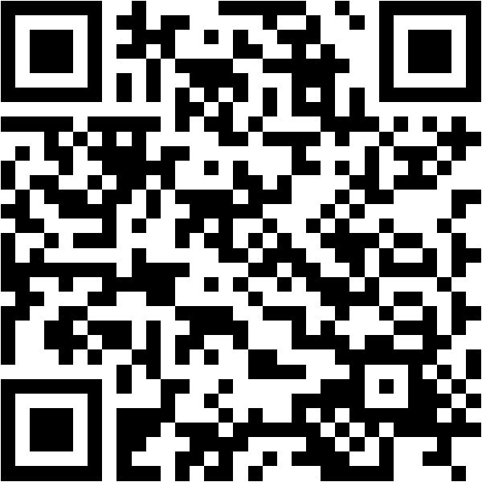

# Join: steffenerickson.github.io/edtech-evidence-lab

::: notes
Phase: lobby. Before class: create the session, save default groups, set phase lobby, project this slide. Check the Supabase project is awake. Print the packet as backup.

This is a data-ethics class, so the question today is not only "does education technology work" but "who says so, and how should that change how much we trust the answer."

Students scan the QR code or type the URL, enter the session code, and pick a group letter. No name or email is collected; each phone gets a random token. Leave this up until the join count on the dashboard matches the room.

Timing target: 75 minutes. The run of show has the 60-minute cuts in brackets.
:::

# Today's Question

What evidence would convince a school district that an education technology improved student learning?

- Define the technology and the outcome (6 min)
- Read, rate, and present nine studies and one news article (30 min)
- Lock ratings, compare them by source, discuss (18 min)
- Agree on five evidence standards (21 min)

::: notes
Put the question on the board in these words and leave it there. Every activity returns to it.

The product of the class is five standards, written by the students and voted on, that a district could use. Say that now so the group work has a destination.
:::

# Poll 1: What Counts as Education Technology?

In one sentence, on your phone: what counts as education technology?

Join: steffenerickson.github.io/edtech-evidence-lab · Session code on the board

::: notes
Phase: defining. The whole join-and-define block is six minutes, so give the definition two of them. Turn on "students can see results" to show definitions on this slide, or read four or five aloud from the dashboard, choosing ones that disagree: one that includes any device, one that limits to instructional software, one that mentions AI.

The point to draw out: the breadth of the definition determines which evidence counts. A study of home computers is evidence about one definition and not another.
:::

# A Working Definition

Education technology: tools designed to support student learning.

- Learning apps and practice platforms
- Personalized or adaptive learning software
- Technology-mediated tutoring
- AI-enabled learning tools

Not today: devices in general, administrative systems, screen time as such.

::: notes
State the definition and the exclusions. AI is included but is not the focus; two of the nine studies are about AI tools.

One study in the set is about general screen time and one is about home computers. They are included so the class can ask whether evidence about the broader category transfers to purposeful instructional tools.
:::

# Which Outcome?

Possible outcomes of education technology:

- Standardized test achievement
- Course grades and completion
- Engagement, attendance, time on task
- Skills the tests do not measure, including skills with the technology itself
- Teacher workload and practice

Today: achievement on standardized tests.

::: notes
Ask for two or three other outcomes before showing the list. Then restrict to standardized test achievement and say plainly what that costs: a technology could raise engagement or teach skills the tests do not measure and still show nothing here. Source E, the home computer study, found both lower grades and higher computer skills, which is the cleanest example of the restriction mattering.
:::

# The Activity

Groups of two or three. Each group has two sources on the Studies page, marked "your group."

1. Read both studies (12 minutes).
2. For each study, agree on the **direction of findings**: positive, negative, mixed, null, or inconclusive.
3. Decide how **credible** the study is, and what you are unsure about (8 minutes).
4. Each group presents both studies in two minutes.

Submit your individual ratings on the Rate page any time before the lock.

::: notes
Phase: reading. Ratings are open from the moment you press it. Reading 12 minutes [8 in the 60-minute version], then discussion 8 minutes [6]. Stay on this slide for both.

Credibility is deliberately undefined. When a group asks what it means, say: that is part of the exercise; decide what it means to you and tell the class.

Sources are not anonymized. Each card ends with its citation and link. Who produced the study, and why, is part of what students weigh when they rate.

While they read, watch the join count and the rating count on the dashboard.
:::

# Group Presentations

Two minutes per group:

- What was studied and how
- Direction of findings
- Who produced it
- How credible, and why
- The one thing you most wanted to know and could not

::: notes
Phase: rating_pre. Two minutes per group [8 minutes total in the 60-minute version]. Keep strict time. Write each group's "one thing you wanted to know" on the board; most will be about how the comparison group was built, whether anyone replicated it, or how long the effect lasted. Those become standards later.

Remind everyone to submit individual ratings on the Rate page before the lock.
:::

# Ratings Are Locked

What you rated, for each of your two sources:

- Direction: positive / negative / mixed / null / inconclusive
- Credibility: 1 (low) to 5 (high)
- One sentence of reason, optional

No rating can be added or changed from here on.

::: notes
Press **locked** on the dashboard before showing this slide. The lock is enforced in the database: after it, a rating cannot be added or changed from any phone. Anyone who did not submit is simply absent from the counts; do not reopen.

Do not advance to "standards_submit" until the lock is set. The dashboard asks for confirmation if you try.
:::

# Results

[Live dashboard: direction counts and credibility distributions, by source]

::: notes
Show the dashboard or the Results page. Point to disagreements, not averages: a source where the same group split between "positive" and "inconclusive," or where credibility ratings span 2 to 5.

Ask one or two students to say what drove their credibility rating: the design, the producer, or something else.

Fallback if the database is down: tally paper ballots by show of hands.
:::

# Three Comparisons

- **B and F.** Company authors, correlational, cited on a sales page; versus independent evaluators, randomized, funded by foundations that also fund tutoring.
- **G and H.** Two randomized trials of the same kind of AI chatbot, both 2025, both independent of the vendor. One positive, one negative.
- **N.** A 54-person preprint becomes "ChatGPT May Be Eroding Critical Thinking Skills."

::: notes
Discussion runs from 0:41 to 0:54. Open each pair on the Results page as you go.

B and F. Source B is a correlational dosage analysis written by employees of the platform's maker, cited on its sales page, and never peer reviewed. Source F is a randomized trial of 17,000 students by independent evaluators, funded by foundations that also fund tutoring. Which concern is bigger: company authorship, or funders with a stake in the answer?

G and H. Both are randomized trials of GPT-4 in a classroom, both from 2025, both independent of the vendor. G found 0.23 standard deviations in English after six weeks of supervised sessions. H found a 17 percent drop on the unassisted exam. Independence did not produce agreement; the designs asked different questions.

N. The article reports a 54-person, non-peer-reviewed preprint with EEG measures of essay writers, and says so in its third paragraph. The headline says "eroding critical thinking skills." The lead author later called that reading "pure clickbait." Ask: what would the headline have to say to be faithful to the study? Then: which version reaches a school board?
:::

# Two Cautions

- A conflict of interest is a reason for scrutiny, not dismissal.
- Independence is not causality.

::: notes
Ask which ratings students would change after the comparisons, and why. Expect B to fall in their estimation and F to hold or rise.

Say both cautions plainly. First, Source B's design would be weak with any author; the company authorship tells you where to look, not what you will find. Second, Source A has no vendor anywhere near it and still cannot support a causal claim, which the report itself says. The question is always what the design can identify, and then who had reasons to shade it.
:::

# What Changed and What Did Not

[Three observations from the discussion, written live]

::: notes
Write three things the class noticed, in their words. Keep them on the board; the standards vote comes next and these are the raw material.

Transition: "You have just applied standards without naming them. Now name them."
:::

# Poll 3: Propose a Standard

On the Standards page, one sentence: a standard the class should use to decide whether a study, or a body of studies, is credible evidence that an education technology changed student learning.

::: notes
Phase: standards_submit. Three minutes. One per student. Watch the count reach the number of students joined.
:::

# Sorting the Standards

Two kinds of standards:

- **For a single study.** Example: a credible comparison group.
- **For the evidence base.** Example: independent replication; publication of null results.

::: notes
Phase: standards_sort. Read submissions from the dashboard. Create a ballot option for each distinct idea, merge duplicates by assigning submissions to the same option, and mark the scope. Six minutes.

Name the distinction: a single study can be excellent and the evidence base still thin. Most student submissions will be single-study standards; ask whether anyone proposed one for the evidence base, and if not, whether the class wants one on the ballot.
:::

# Vote

On the Standards page, choose up to five.

::: notes
Phase: standards_vote. Four minutes. The database rejects more than five selections. Resubmitting replaces the earlier ballot.
:::

# Our Five Standards

[Live: the five standards with the most votes]

::: notes
Phase: final. Tick the five winners on the dashboard. If there is a tie at fifth place, show the tied options, take a voice vote, and tick the winner.

For each standard, one sentence on why it matters, using a study from today as the example. Then two questions: what did we leave out, and how would a district use these five when a vendor presents a study?

End on the five; the two source slides after this are reference only. Afterwards set the phase to closed, export the CSV if you want it, and delete the session within 30 days.
:::

# Sources (A–F)

- A. OECD (2015). *Students, Computers and Learning: Making the Connection.* doi:10.1787/9789264239555-en
- B. Weatherholtz, Grimaldi & Hill (2022). *Use of MAP Accelerator associated with better-than-projected gains in MAP Growth scores.* Khan Academy.
- C. Dynarski et al. (2007). *Effectiveness of Reading and Mathematics Software Products.* NCEE 2007-4005.
- D. Doss et al. (2025). *AI Use in Schools Is Quickly Increasing but Guidance Lags Behind.* RAND RR-A4180-1.
- E. Malamud & Pop-Eleches (2011). Home computer use and the development of human capital. *QJE*, 126(2).
- F. Bhatt et al. (2025). *Personalized Learning Initiative Interim Report.* UChicago Education Lab & MDRC.
::: notes
Continued on the next slide.
:::

# Sources (continued)

- G. De Simone et al. (2025). *From Chalkboards to Chatbots.* World Bank PRWP 11125.
- H. Bastani et al. (2025). Generative AI without guardrails can harm learning. *PNAS*, 122(26).
- I. Madigan et al. (2019). Screen time and developmental screening. *JAMA Pediatrics*, 173(3).
- N. Chow (2025, June 17). ChatGPT may be eroding critical thinking skills, according to a new MIT study. *TIME.*

Site and packet: steffenerickson.github.io/edtech-evidence-lab

::: notes
Full citations with links are on every card on the Studies page and in the packet. This deck's source and the site's source are at github.com/steffenerickson/edtech-evidence-lab.
:::
