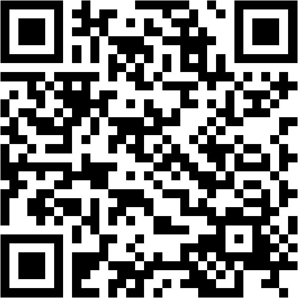

# Join: steffenerickson.github.io/edtech-evidence-lab

::: notes
Phase: defining. Before class: create the session, save default groups, project this slide. Definitions are open from the start, so students can answer Poll 1 as soon as they join. Check the Supabase project is awake. Print the packet as backup.

This is a data-ethics class, so the question today is not only "does education technology work" but "who says so, and how should that change how much we trust the answer."

Students scan the QR code or type the URL, enter the session code, and pick a group letter. No name or email is collected; each phone gets a random token. Leave this up until the join count on the dashboard matches the room.

Timing target: 75 minutes. The run of show has the 60-minute cuts in brackets.
:::

# Today's Question

Imagine you are a district leader. What evidence would convince you that an educational technology would improve student learning in your district?

- Define the technology and the outcome
- Read, rate, and present nine sources on ed-tech effectiveness
- Develop five standards for evaluating the quality of evidence about educational technology's impact on student learning

::: notes
Put the question on the board in these words and leave it there. Every activity returns to it.

The product of the class is five standards, written by the students and voted on, that a district could use. Say that now so the group work has a destination.
:::

# Poll 1: What Counts as Education Technology?

In one sentence, on your phone: what counts as education technology?

Join: steffenerickson.github.io/edtech-evidence-lab · Session code on the board

::: notes
The whole join-and-define block is six minutes, so give the definition two of them. Project the Results page, where definitions appear as they are submitted, or read four or five aloud from the dashboard, choosing ones that disagree: one that includes any device, one that limits to instructional software, one that mentions AI.

The point to draw out: the breadth of the definition determines which evidence counts. A study of home computers is evidence about one definition and not another.
:::

# A Working Definition

Education technology: tools designed to support student learning.

- Learning apps and practice platforms
- Personalized or adaptive learning software
- Technology-mediated tutoring
- AI-enabled learning tools

Not today: devices in general, administrative systems, screen time as such.

::: notes
State the definition and the exclusions. AI is included but is not the focus; two of the nine studies are about AI tools.

One study in the set is about general screen time and one is about home computers. They are included so the class can ask whether evidence about the broader category transfers to purposeful instructional tools.
:::

# Which Outcome?

Possible outcomes of education technology:

- Standardized test achievement
- Course grades and completion
- Engagement, attendance, time on task
- Skills the tests do not measure, including skills with the technology itself
- Teacher workload and practice

Today: achievement on standardized tests.

::: notes
Ask for two or three other outcomes before showing the list. Then restrict to standardized test achievement and say plainly what that costs: a technology could raise engagement or teach skills the tests do not measure and still show nothing here. Source E, the home computer study, found both lower grades and higher computer skills, which is the cleanest example of the restriction mattering.
:::

# The Activity

Groups of two. I will assign groups. Each group has two sources on the Studies page, marked "your group."

1. Read both study summaries (12 minutes).
2. For each study, agree on the **direction of findings**: positive, negative, mixed, null, or inconclusive.
3. Decide how **credible** the study is, and what you are unsure about (8 minutes).
4. Submit your direction of findings and credibility ratings on the Rate page.
5. Each group presents their studies and ratings in two minutes.

::: notes
Phase: reading. Ratings are open from the moment you press it. Reading 12 minutes [8 in the 60-minute version], then discussion 8 minutes [6]. Stay on this slide for both.

Credibility is deliberately undefined. When a group asks what it means, say: that is part of the exercise; decide what it means to you and tell the class.

Sources are not anonymized. Each card ends with its citation and link. Who produced the study, and why, is part of what students weigh when they rate.

While they read, watch the join count and the rating count on the dashboard.
:::

# Group Presentations

Two minutes per group:

- What was studied and how
- Direction of findings
- Who produced it
- How credible, and why
- The one thing you most wanted to know and could not

::: notes
Phase: ratings. Two minutes per group [8 minutes total in the 60-minute version]. Keep strict time. Write each group's "one thing you wanted to know" on the board; most will be about how the comparison group was built, whether anyone replicated it, or how long the effect lasted. Those become standards later.

Remind everyone to submit individual ratings on the Rate page before the lock.
:::

# What the Studies Should Have Raised

- **The comparison group.** A randomized trial (C, F, G, H) can identify an effect; a dosage analysis (B) or a cross-country correlation (A) cannot, whoever wrote it.
- **Who produced it, and why.** B was written by the platform's employees and cited on its sales page. F was funded by foundations that also fund tutoring. A conflict of interest is a reason for scrutiny, not dismissal.
- **Independence is not causality.** A has no vendor anywhere near it and still cannot support a causal claim, which the report itself says.
- **Same tool, opposite results.** G and H are both independent randomized trials of a GPT-4 tutor in 2025. One found gains; one found a 17 percent drop on the unassisted exam. The designs asked different questions.
- **The study versus the headline.** N turns a 54-person, non-peer-reviewed preprint into "ChatGPT May Be Eroding Critical Thinking Skills." The lead author called that reading "pure clickbait."

::: notes
Show this after the presentations, before the standards poll. Tie each point to what a group said; most of the "one thing you wanted to know" items on the board will fall under the first or fourth bullet.

B and F: ask which concern is bigger, company authorship or funders with a stake in the answer. Source B's design would be weak with any author; the authorship tells you where to look, not what you will find.

G and H: G found 0.23 standard deviations in English after six weeks of supervised sessions. H measured performance once the tool was taken away. Independence did not produce agreement.

N: ask what the headline would have to say to be faithful to the study, and which version reaches a school board.

Transition: "You have just applied standards without naming them. Now name them."
:::

# Poll 3: Propose Standards

On the Standards page, up to three one-sentence standards: a rule the class should use to decide whether a study, or a body of studies, is credible evidence that an education technology changed student learning.

Two kinds of standards:

- **For a single study.** Example: a credible comparison group; study population is relevant for your use case.
- **For the evidence base.** Example: study conducted by independent evaluators; replication of the findings in multiple settings; publication of null results.

::: notes
Phase: standards_submit. Four minutes. Up to three per student; each can be removed and rewritten until you advance the phase. Watch the count on the dashboard.

Name the distinction: a single study can be excellent and the evidence base still thin. Most submissions will be single-study standards; ask whether anyone proposed one for the evidence base.

Skim the submissions on the dashboard as they arrive. Delete exact duplicates or anything unfit for the screen; everything left goes straight onto the ballot.
:::

# Vote

On the Standards page, choose up to five of the standards the class proposed.

::: notes
Phase: standards_vote. Four minutes. Every submission is on the ballot, shown in random order on each phone. The database rejects more than five selections. Resubmitting replaces the earlier ballot.
:::

# Our Five Standards

[Live: the five standards with the most votes, ranked 1 to 5]

::: notes
Phase: final. The Standards page and the dashboard rank submissions by votes; the top five are the result. Ties are broken by whichever was submitted first, so if two are tied at the cutoff, say so and let the class see both.

For each standard, one sentence on why it matters, using a study from today as the example. Then two questions: what did we leave out, and how would a district use these five when a vendor presents a study?

End on the five; the two source slides after this are reference only. Afterwards set the phase to closed, export the CSV if you want it, and delete the session within 30 days.
:::

# Sources (A–F)

- A. OECD (2015). *Students, Computers and Learning: Making the Connection.* doi:10.1787/9789264239555-en
- B. Weatherholtz, Grimaldi & Hill (2022). *Use of MAP Accelerator associated with better-than-projected gains in MAP Growth scores.* Khan Academy.
- C. Dynarski et al. (2007). *Effectiveness of Reading and Mathematics Software Products.* NCEE 2007-4005.
- D. Doss et al. (2025). *AI Use in Schools Is Quickly Increasing but Guidance Lags Behind.* RAND RR-A4180-1.
- E. Malamud & Pop-Eleches (2011). Home computer use and the development of human capital. *QJE*, 126(2).
- F. Bhatt et al. (2025). *Personalized Learning Initiative Interim Report.* UChicago Education Lab & MDRC.

::: notes
Continued on the next slide.
:::

# Sources (continued)

- G. De Simone et al. (2025). *From Chalkboards to Chatbots.* World Bank PRWP 11125.
- H. Bastani et al. (2025). Generative AI without guardrails can harm learning. *PNAS*, 122(26).
- I. Madigan et al. (2019). Screen time and developmental screening. *JAMA Pediatrics*, 173(3).
- N. Chow (2025, June 17). ChatGPT may be eroding critical thinking skills, according to a new MIT study. *TIME.*

Site and packet: steffenerickson.github.io/edtech-evidence-lab

::: notes
Full citations with links are on every card on the Studies page and in the packet. This deck's source and the site's source are at github.com/steffenerickson/edtech-evidence-lab.
:::
